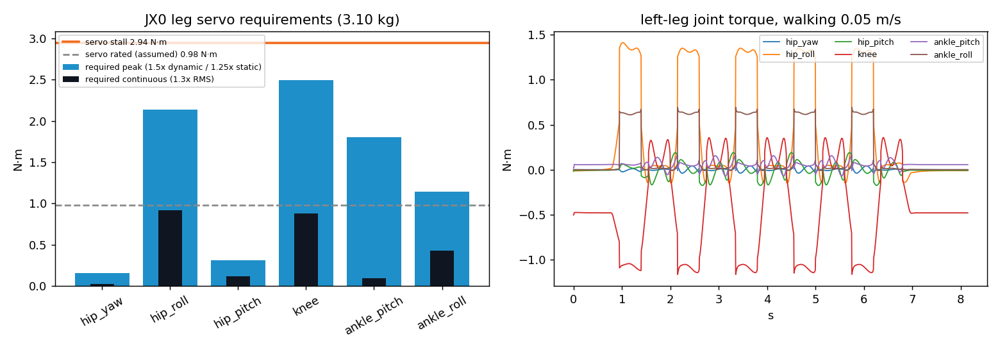

# JX0 servo sizing (CALCULATED (servo data and masses ASSUMED until measured))

Design `jx0/design_point.yaml`, total mass 2.99 kg, walking hip height 0.19 m. Servo: Feetech STS3215 12 V serial bus servo (ST3215-C018 / Waveshare ST3215; 30 kg·cm stall, 10 kg·cm rated at 12 V); stall 2.94 N·m, rated 0.98 N·m (assumed 1/3 of stall), no-load 4.72 rad/s.
Checks: 1.5 x dynamic peak (1.25 x static) <= stall; 1.3 x walking RMS <= rated; 1.5 x torque within the linear torque-speed line at every sample.

| Joint | Dynamic peak N·m (scenario) | Static peak N·m (case) | Required peak | Peak margin | Walking RMS | Continuous margin | Peak speed rad/s | Torque-speed use | Pass |
|---|---|---|---|---|---|---|---|---|---|
| hip_yaw | 0.101 (turn_10deg_per_step) | 0.0 (stand_deep_squat) | 0.151 | 19.46 | 0.017 | 44.05 | 0.73 | 6 % (turn_10deg_per_step) | yes |
| hip_roll | 1.371 (walk_nominal_0.05ms) | 1.666 (single_leg_cop_outer_edge) | 2.082 | 1.41 | 0.684 | 1.1 | 0.96 | 75 % (walk_brisk_0.055ms) | yes |
| hip_pitch | 0.21 (walk_brisk_0.055ms) | 0.241 (single_leg_cop_heel) | 0.316 | 9.32 | 0.088 | 8.54 | 2.23 | 14 % (walk_brisk_0.055ms) | yes |
| knee | 1.147 (turn_10deg_per_step) | 1.909 (single_leg_cop_inner_edge) | 2.386 | 1.23 | 0.645 | 1.17 | 2.4 | 61 % (turn_10deg_per_step) | yes |
| ankle_pitch | 0.174 (walk_brisk_0.055ms) | 1.383 (single_leg_cop_heel) | 1.729 | 1.7 | 0.073 | 10.37 | 2.33 | 12 % (walk_brisk_0.055ms) | yes |
| ankle_roll | 0.67 (turn_10deg_per_step) | 0.88 (single_leg_cop_inner_edge) | 1.1 | 2.67 | 0.32 | 2.36 | 0.96 | 41 % (turn_10deg_per_step) | yes |

| Scenario | ZMP tracking error (mm) |
|---|---|
| walk_slow_0.042ms | 3.13 |
| walk_nominal_0.05ms | 3.13 |
| walk_brisk_0.055ms | 3.13 |
| turn_10deg_per_step | 3.13 |
| squat_2.5cm_1.6s | 3.13 |

